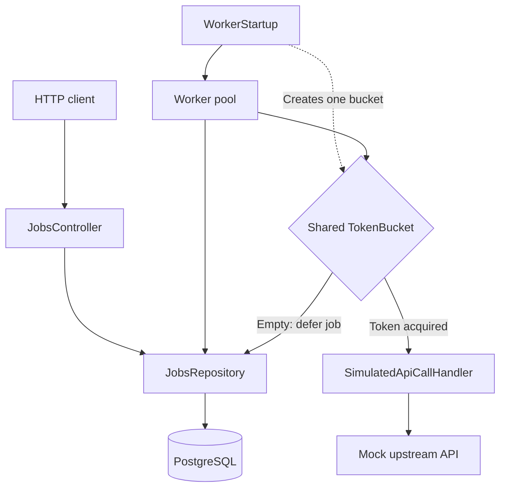
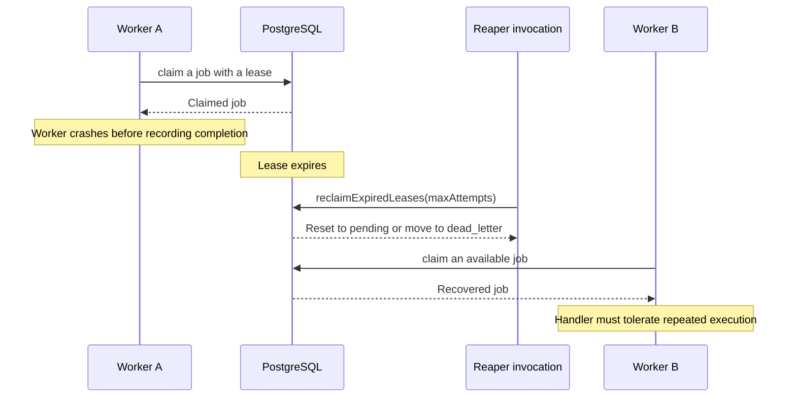
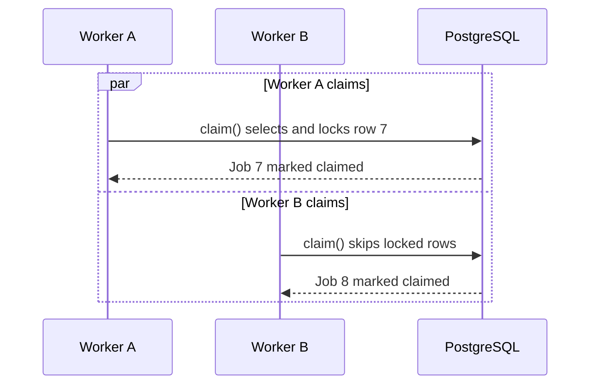
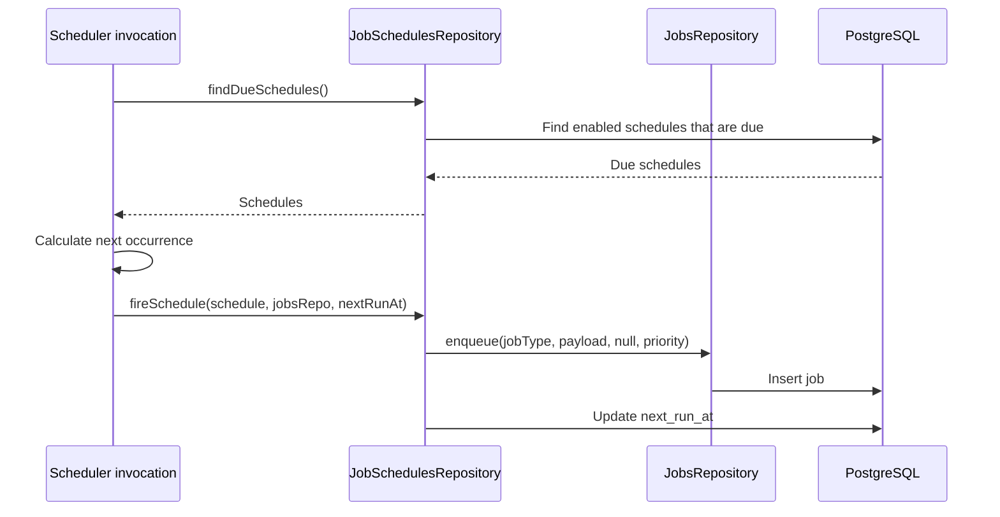
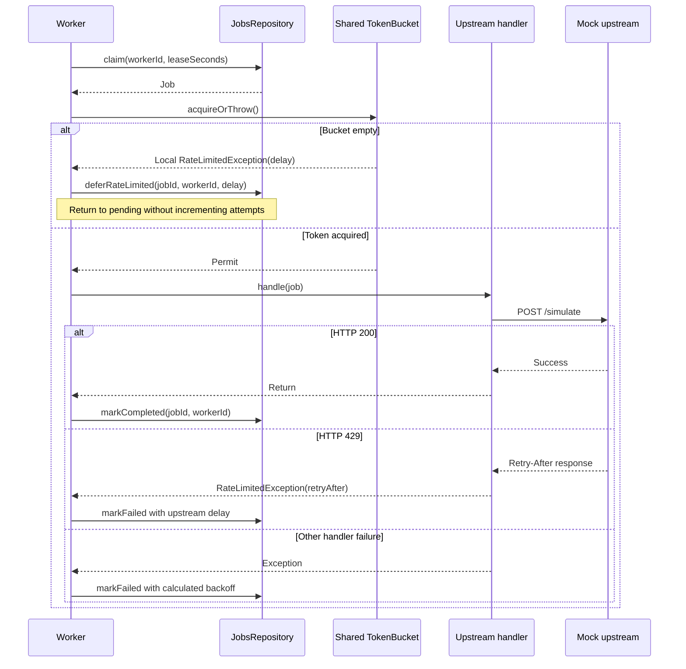
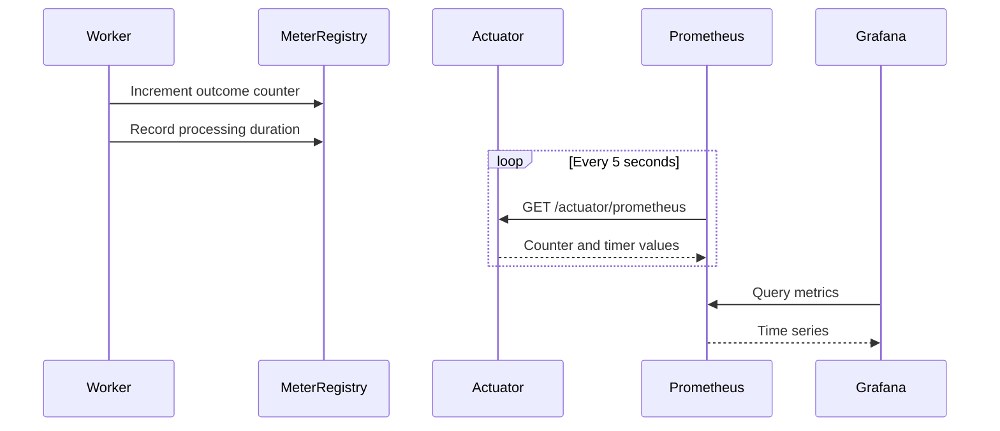
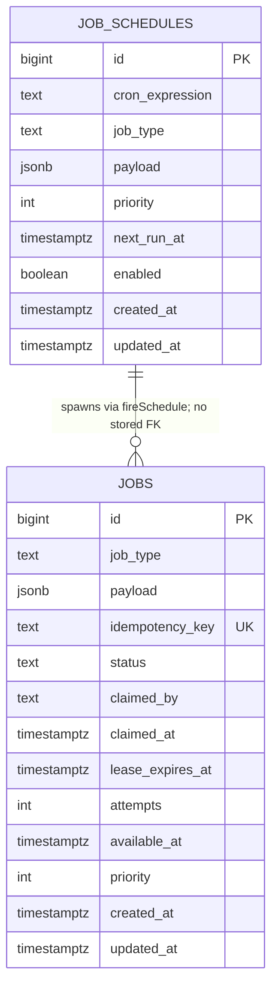
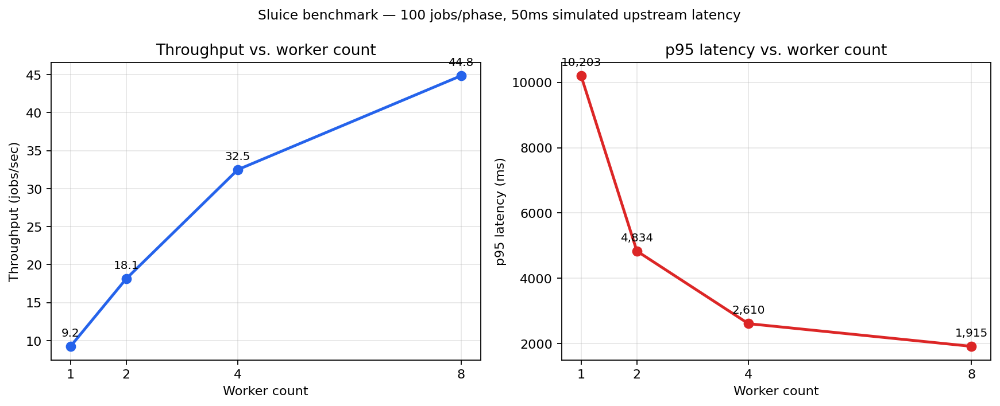

# Sluice

[](https://github.com/amanxsays/Sluice/actions/workflows/ci.yml)

A PostgreSQL-backed job scheduler and durable task queue, built in Java for rate-limited external API workloads such as LLM APIs and third-party services.

Sluice combines proactive outbound rate limiting with reactive HTTP 429 handling. Workers share an in-memory Token Bucket before calling the upstream API, while real upstream rate-limit responses continue to use the existing `Retry-After` retry path.

The name comes from a sluice gate: it controls the rate at which work flows through.

> **Status:** The queue engine, autonomous worker pool, proactive Token Bucket limiter, reactive retries, Docker Compose stack, and Prometheus/Grafana observability are implemented. The latest local test run completed with **33 tests, 0 failures, 0 errors, and 0 skipped tests**. Automatic reaper scheduling, periodic worker heartbeats, and recurring-schedule timer wiring remain pending. See [Project status / roadmap](#project-status--roadmap).

---

## Table of contents

- [Why this exists](#why-this-exists)
- [Features](#features)
- [Architecture](#architecture)
- [How it works](#how-it-works)
  - [Job lifecycle](#job-lifecycle)
  - [Crash recovery: leases, heartbeats, and the reaper](#crash-recovery-leases-heartbeats-and-the-reaper)
  - [Concurrent claiming with `SKIP LOCKED`](#concurrent-claiming-with-skip-locked)
  - [Recurring schedules](#recurring-schedules)
  - [Autonomous job processing](#autonomous-job-processing)
  - [Proactive Token Bucket rate limiting](#proactive-token-bucket-rate-limiting)
  - [Observability: metrics, Prometheus, and Grafana](#observability-metrics-prometheus-and-grafana)
  - [Schema](#schema)
- [Tech stack](#tech-stack)
- [Running it locally](#running-it-locally)
- [Configuration](#configuration)
- [Running the tests](#running-the-tests)
- [Benchmark results](#benchmark-results)
- [Key design decisions](#key-design-decisions)
- [Project status / roadmap](#project-status--roadmap)

---

## Why this exists

Calling an external API becomes a queueing problem when requests must survive process failures, wait through provider rate limits, and retry without overwhelming the upstream service.

Sluice explores those concerns through a durable PostgreSQL queue:

- How can concurrent workers claim different jobs safely?
- How can unfinished work be recovered after a worker crashes?
- How should retries respect an upstream service's `Retry-After` response?
- How can workers proactively control outbound traffic before receiving a 429?
- How can local throttling defer work without exhausting its failure budget?

The queue is built directly on PostgreSQL. Job persistence, claiming, retry scheduling, and recovery primitives are implemented explicitly so their behavior can be inspected and tested.

Duplicate submission and duplicate execution are separate concerns. Sluice's enqueue idempotency keys prevent duplicate queue rows. Handlers still need appropriate idempotency for external side effects if a job executes more than once.

## Features

- **PostgreSQL-backed queue.** Job durability comes from the database.
- **Safe concurrent claiming.** Workers use `SELECT ... FOR UPDATE SKIP LOCKED` to claim available jobs without taking the same row.
- **Crash-recovery primitives.** Leases, heartbeat updates, and expired-lease reclamation are implemented and tested. Automatic timer wiring is tracked in the roadmap.
- **Retries with exponential backoff and full jitter.** General handler failures are rescheduled through the existing retry mechanism.
- **Dead-letter handling.** Jobs that exhaust their failure budget stop retrying automatically.
- **Idempotent enqueueing.** A database uniqueness constraint and `ON CONFLICT ... DO NOTHING` prevent duplicate submissions with the same idempotency key.
- **Priority-aware claiming.** Higher-priority jobs are selected before lower-priority jobs, followed by creation time.
- **Recurring schedule support.** Cron-based templates create ordinary jobs independently of previous executions. Repository logic is implemented; timer-driven firing remains pending.
- **Autonomous worker pool.** Configurable background workers start when `sluice-api` boots.
- **Proactive outbound rate limiting.** All `call-api` workers started by one application instance share a configurable in-memory Token Bucket.
- **Deferral without spending attempts.** An empty local bucket returns a job to `pending` with a future `available_at`, preserving its failed-attempt count.
- **Reactive HTTP 429 handling.** Actual upstream 429 responses retain their existing `Retry-After` scheduling behavior.
- **Live observability.** Micrometer counters and timers are exposed through Spring Boot Actuator, scraped by Prometheus, and available to Grafana.
- **Automated tests and CI.** Pure Java unit tests and PostgreSQL integration tests run through Maven and the GitHub Actions workflow.
- **One-command deployment.** Docker Compose starts PostgreSQL, the API and workers, mock upstream, Prometheus, and Grafana.
- **Benchmark harness.** Worker scaling can be measured against the mock upstream. Existing results are an unthrottled baseline.
- **HTTP enqueue API.** Submit jobs through `POST /jobs`.

## Architecture

Sluice has three Maven modules:

| Module | Responsibility |
|---|---|
| `sluice-core` | Queue engine, repositories, worker loop, retry logic, token bucket, and metrics instrumentation |
| `sluice-api` | Spring Boot HTTP API, configuration, dependency wiring, and worker startup |
| `mock-upstream` | Standalone HTTP service that simulates latency and HTTP 429 responses |

Important components:

| Module | Component | Responsibility |
|---|---|---|
| `sluice-core` | `JobsRepository` | Enqueue, claim, heartbeat, reclaim expired leases, defer locally throttled jobs, record failures, and complete jobs |
| `sluice-core` | `JobSchedulesRepository` | Find due schedules and create their job executions |
| `sluice-core` | `BackoffCalculator` | Exponential backoff with jitter |
| `sluice-core` | `CronScheduleCalculator` | Calculate the next cron occurrence |
| `sluice-core` | `Worker` | Claim a job, invoke its handler, and complete, defer, or retry it |
| `sluice-core` | `JobHandler` | Interface for job-specific work |
| `sluice-core` | `TokenBucket` | Thread-safe in-memory admission control for outbound calls |
| `sluice-core` | `SimulatedApiCallHandler` | Make HTTP calls to the mock upstream and interpret responses |
| `sluice-core` | `RateLimitedException` | Carry a retry delay and distinguish local throttling from upstream 429 |
| `sluice-api` | `JobsController` | Handle `POST /jobs` |
| `sluice-api` | `WorkerStartup` | Create one shared bucket and handler map, then start the workers |
| `sluice-api` | `AppConfig` | Construct core repositories using Spring's `DataSource` |
| `mock-upstream` | `SimulateController` | Handle `POST /simulate` with configurable latency and 429 behavior |

Flyway migrations live in `sluice-core/src/main/resources/db/migration` and are available to `sluice-api` through its dependency on core.

The repository root also contains:

- `docker-compose.yml`
- `prometheus.yml`
- `.github/workflows/ci.yml`
- `sluice-benchmark-results.png`

### Module boundaries

`sluice-core` uses plain Java and JDBC and has no Spring dependency. Its repositories, token bucket, and workers can be tested without starting a Spring application context.

`sluice-api` supplies configuration, the `DataSource`, and the concrete `MeterRegistry`. `WorkerStartup` connects these components and creates the shared token bucket before starting worker threads.

`mock-upstream` is an independent Spring Boot application. Tests and benchmarks can exercise actual HTTP behavior without calling a paid external service.



The database coordinates job ownership. The token bucket coordinates outbound admission within the current application instance.

## How it works

### Job lifecycle

Jobs begin in `pending`, become `claimed` when a worker acquires them, and move to `completed` after successful handling.

An actual failure increments `attempts` and either schedules a retry or moves the job to `dead_letter`.

Local token-bucket rejection follows a separate path: the job returns to `pending` with a future availability time, but its attempt count does not change.

```mermaid
stateDiagram-v2
    [*] --> pending : enqueue()

    pending --> claimed : claim an available job

    claimed --> completed : handler succeeds

    claimed --> pending : local throttle; attempts unchanged
    claimed --> pending : failure; retry budget remains
    claimed --> pending : expired lease reclaimed; budget remains

    claimed --> dead_letter : failure budget exhausted
    claimed --> dead_letter : lease reclamation exhausts budget

    completed --> [*]
    dead_letter --> [*]
```



The existing claim query selects only jobs whose status is `pending` and whose `available_at` is due. Both ordinary retries and local rate-limit deferrals use this mechanism.

### Crash recovery: leases, heartbeats, and the reaper

A claimed job receives a lease deadline. The repository provides:

- `heartbeat(...)` to extend an owned job's lease.
- `reclaimExpiredLeases(...)` to release expired claims and account for failed attempts.

These primitives support recovery when a worker disappears without reporting a result.

**Current integration status:** the running worker does not yet send periodic heartbeats, and the application does not automatically invoke the reaper on a timer. The recovery flow below describes the implemented repository behavior when reclamation is invoked.



Recovery can repeat work if the upstream side effect succeeded before the worker crashed. Enqueue idempotency keys do not, by themselves, prevent repeated external side effects.

### Concurrent claiming with `SKIP LOCKED`

The claim operation selects an eligible job and updates its ownership in one SQL statement.

`FOR UPDATE SKIP LOCKED` allows another worker to skip a row that is already locked and claim another eligible job instead of waiting for that row.



An existing concurrency test runs four threads against 20 seeded jobs and verifies that every claimed job ID is unique.

### Recurring schedules

A row in `job_schedules` is a template for future executions. Firing a schedule creates an ordinary job through the enqueue path and advances the schedule's next occurrence.

The spawned job's success or failure is separate from the schedule's future occurrences.



The repository and cron calculation logic are implemented and tested. Automatic timer-driven invocation remains pending.

### Autonomous job processing

Each `Worker` runs on a background thread started by `WorkerStartup`.

`processOnce()` performs one claim-and-handle cycle. `run()` repeatedly invokes it. When no eligible job is available, the existing loop sleeps for two seconds before polling again.

For `call-api` jobs, the registered handler first checks the shared bucket and then invokes `SimulatedApiCallHandler`.



A `true` result from `processOnce()` means a job was claimed and processed through one of these paths. It does not necessarily mean that the job completed successfully.

### Proactive Token Bucket rate limiting

The limiter controls outbound API-call admission before workers invoke the upstream handler.

It supports:

- Configurable capacity.
- Configurable refill rate per second.
- Controlled bursts.
- Fractional token refill.
- Thread-safe acquisition.
- Monotonic elapsed-time calculation using `System.nanoTime()`.
- Rescheduling when empty without waiting for token refill.

#### One bucket shared by the worker pool

`WorkerStartup.run()` creates the bucket and handler wrapper before entering the worker creation loop:

```java
TokenBucket bucket = new TokenBucket(bucketCapacity, refillPerSecond);
JobHandler upstreamHandler = new SimulatedApiCallHandler(mockUpstreamUrl);

JobHandler limitedHandler = job -> {
    bucket.acquireOrThrow();
    upstreamHandler.handle(job);
};

Map<String, JobHandler> handlers = Map.of("call-api", limitedHandler);
```

Every worker receives the same handler map. The wrapper captures the same bucket instance, so adding worker threads does not create additional independent allowances.

If acquisition throws, execution never reaches `upstreamHandler.handle(job)`.

#### Refill and acquisition

The bucket starts full. On each acquisition attempt, it calculates the tokens earned since its previous accounting update:

```text
availableTokens = min(
    capacity,
    availableTokens + elapsedSeconds * refillPerSecond
)
```

There is no scheduled refill task. Tokens are replenished lazily when acquisition is attempted.

Refill, checking, and consumption occur inside one synchronized method. HTTP execution happens after this method releases its lock.

One successful acquisition consumes one token. Tokens represent API-call permits, not LLM input or output tokens.

#### Deferral when empty

When fewer than one token is available, the bucket calculates a retry delay from the missing token balance and refill rate.

The existing queue schedules retries in whole seconds, so the delay rounds upward and is at least one second.

`RateLimitedException.localThrottle(delay)` identifies a local admission rejection. `Worker` routes it to:

```java
jobsRepository.deferRateLimited(job.id(), workerId, delay);
```

The database update:

- Returns the job to `pending`.
- Sets a future `available_at`.
- Clears `claimed_by`, `claimed_at`, and `lease_expires_at`.
- Updates `updated_at`.
- Preserves `attempts`.
- Applies only if the specified worker still owns a job in `claimed` state.

This prevents a healthy job from exhausting its failure budget merely because other jobs consumed the available tokens.

The worker does not sleep for the token delay. It can immediately process other eligible work.

#### Proactive and reactive behavior

| Situation | Scheduling behavior | Failed attempts |
|---|---|---|
| Token available, handler succeeds | Mark completed | Unchanged |
| Local bucket empty | Defer using `available_at` | Unchanged |
| Actual upstream HTTP 429 | Existing `Retry-After` retry path | Incremented |
| Other handler exception | Existing backoff calculation | Incremented |

The existing `RateLimitedException(int retryAfterSeconds)` constructor continues to represent an upstream rate-limit response.

`SimulatedApiCallHandler` still expects an integer-seconds `Retry-After` header and falls back to one second when the header is absent. HTTP-date values are not currently supported.

#### Scope and limitations

- **Single application instance:** workers started by one `WorkerStartup` share one bucket. Another JVM would have an independent allowance.
- **In-memory state:** restarting the application creates a fresh, full bucket.
- **One shared allowance:** all wrapped `call-api` jobs use the same bucket; there are no separate per-tenant or per-provider buckets.
- **Whole-second deferrals:** retry scheduling is coarser than the bucket's elapsed-time accounting.
- **Polling affects throughput:** the existing idle polling interval can add further delay.
- **No future reservation:** a deferred job must acquire a token again when it becomes eligible.
- **No token refund:** a consumed token remains consumed if the handler later fails.
- **Rate and concurrency differ:** bucket settings control admission rate; worker count controls concurrent execution.
- **Reactive 429 remains per job:** a 429 reschedules that job; it does not change the bucket's refill rate or impose a shared cooldown.

A globally coordinated limiter for multiple application instances remains future work.

### Observability: metrics, Prometheus, and Grafana

`Worker` records metrics through Micrometer in `sluice-core`.

The counter `sluice.worker.jobs` uses these outcome tags:

| Outcome | Meaning |
|---|---|
| `completed` | The handler completed and the worker followed its completion path |
| `failed` | An upstream 429 or another handler exception followed the existing failure path |
| `deferred` | A locally throttled job was successfully rescheduled without consuming an attempt |
| `no_handler` | No handler was registered for the job type |

These are processing counters, not a count of unique submissions. In the existing worker implementation, a missing handler records `no_handler` and then follows the general failure path, which also records `failed`.

`sluice.worker.job.duration` measures the timed handler/completion block after a claim. It also records attempts rejected by the local bucket. It does not measure the job's total waiting time in the queue.

`sluice-api` supplies the concrete `MeterRegistry` and exposes metrics at `/actuator/prometheus`. Prometheus scrapes this endpoint every five seconds, and Grafana queries the stored series.



Example PromQL for completed processing rate:

```promql
sum(rate(sluice_worker_jobs_total{outcome="completed"}[1m]))
```

Example PromQL for local deferral rate:

```promql
sum(rate(sluice_worker_jobs_total{outcome="deferred"}[1m]))
```

Tests and the benchmark harness use `SimpleMeterRegistry`, so worker instrumentation can be exercised without running Prometheus.

### Schema



`status` is `TEXT` with a `CHECK` constraint allowing `pending`, `claimed`, `completed`, `failed`, and `dead_letter`.

The worker's retry paths use `pending` and `dead_letter`; local deferral uses `pending`.

The Token Bucket feature requires no schema migration. It reuses the existing claim, availability, and attempt-tracking columns.

## Tech stack

| Component | Technology |
|---|---|
| Language | Java 21 |
| Web framework | Spring Boot 4.1.1 |
| Database access | Plain JDBC in `sluice-core` |
| Database | PostgreSQL 16 |
| Migrations | Flyway |
| Outbound HTTP | Java's built-in `java.net.http.HttpClient` |
| Proactive rate limiting | In-memory Token Bucket using `System.nanoTime()` and synchronized acquisition |
| Metrics | [Micrometer](https://micrometer.io/) and Spring Boot Actuator |
| Metrics storage and dashboards | Prometheus and Grafana |
| CI | GitHub Actions |
| Testing | JUnit Jupiter, Testcontainers, controllable-clock unit tests, and a local HTTP test server |
| Cron parsing | [cron-utils](https://github.com/jmrozanec/cron-utils) |
| Containerization | Docker and Docker Compose with multi-stage builds |

## Running it locally

### Full stack with Docker Compose

From the repository root:

```bash
docker compose up --build
```

This builds the Java services from source and starts:

| Service | Host port |
|---|---|
| PostgreSQL | `5432` |
| Sluice API | `8080` |
| Mock upstream | `8081` |
| Prometheus | `9090` |
| Grafana | `3000` |

PostgreSQL has a health check, and the API waits for it to become healthy.

Enqueue a job:

```bash
curl -X POST http://localhost:8080/jobs \
  -H "Content-Type: application/json" \
  -d '{"jobType":"call-api","payload":"{\"latencyMs\":200,\"shouldFail\":false,\"retryAfterSeconds\":0}","idempotencyKey":null,"priority":0}'
```

A background worker claims the job when it is eligible. If the shared bucket permits the call, the worker invokes mock upstream and completes the job on success. If the bucket is empty, the worker defers the job.

Completion time depends on queue load, token availability, polling, and upstream latency.

To exercise reactive HTTP 429 handling:

```bash
curl -X POST http://localhost:8080/jobs \
  -H "Content-Type: application/json" \
  -d '{"jobType":"call-api","payload":"{\"latencyMs\":0,\"shouldFail\":true,\"retryAfterSeconds\":7}","idempotencyKey":null,"priority":0}'
```

When admitted by the bucket, this job receives a 429 from mock upstream and follows the existing seven-second retry path. Because its payload keeps requesting failure, later admitted attempts also fail until the configured attempt budget is exhausted.

### Observe the application

- Prometheus targets: `http://localhost:9090/targets`
- Grafana: `http://localhost:3000`
- Application metrics: `http://localhost:8080/actuator/prometheus`

For a fresh Grafana instance, the default credentials are `admin` / `admin`. Add Prometheus as a data source using `http://prometheus:9090`.

Useful series include:

- `sluice_worker_jobs_total`
- `sluice_worker_job_duration_seconds_sum`
- `sluice_worker_job_duration_seconds_count`

Filter the outcome counter by `deferred` to observe local throttling separately from failures.

### Run the Java services with Maven

For local development, use JDK 21 and Maven, with Docker available for PostgreSQL and integration tests.

Start PostgreSQL and build the project:

```bash
docker compose up -d postgres
mvn install
```

In one terminal, start mock upstream:

```bash
mvn -pl mock-upstream spring-boot:run
```

In another terminal, start the API and workers:

```bash
mvn -pl sluice-api spring-boot:run
```

The default configuration uses PostgreSQL at `localhost:5432` and mock upstream at `localhost:8081`.

## Configuration

The worker and limiter settings are in:

```text
sluice-api/src/main/resources/application.yml
```

Current defaults:

```yaml
sluice:
  rate-limit:
    capacity: 10
    refill-per-second: 5.0
  worker:
    count: 2
    lease-seconds: 30
    max-attempts: 5
  mock-upstream:
    url: http://localhost:8081/simulate
```

| Property | Default | Meaning |
|---|---:|---|
| `sluice.rate-limit.capacity` | `10` | Maximum accumulated tokens and initial burst allowance |
| `sluice.rate-limit.refill-per-second` | `5.0` | Tokens replenished per second |
| `sluice.worker.count` | `2` | Background worker threads started by the application |
| `sluice.worker.lease-seconds` | `30` | Initial lease duration for a claimed job |
| `sluice.worker.max-attempts` | `5` | Failed-attempt budget before dead-lettering |
| `sluice.mock-upstream.url` | `http://localhost:8081/simulate` | Upstream endpoint used by the handler |

Capacity must be at least one. The refill rate must be positive and finite. Invalid limiter settings fail during worker startup.

A fractional refill rate is supported. For example, `0.5` replenishes one token every two seconds.

The default bucket begins with 10 tokens and replenishes five per second. It allows controlled bursts; it does not enforce a strict fixed-window limit of five calls in every calendar second.

Docker Compose overrides the database and upstream addresses to use container networking. Rebuild the application image after changing source-controlled configuration when using the full Compose setup.

## Running the tests

Latest local result after integrating the Token Bucket feature:

```text
[INFO] Tests run: 33, Failures: 0, Errors: 0, Skipped: 0
```

Run the core suite:

```bash
mvn -pl sluice-core test
```

Run the full Maven reactor's tests:

```bash
mvn test
```

The PostgreSQL integration tests require a running Docker daemon because they use Testcontainers.

### Pure logic tests

`BackoffCalculatorTest`, `CronScheduleCalculatorTest`, and `TokenBucketTest` do not require Docker.

Run the bucket tests independently:

```bash
mvn -pl sluice-core -Dtest=TokenBucketTest test
```

`TokenBucketTest` verifies:

- Initial burst admission up to capacity.
- Rejection when empty.
- Local-throttle identification and upward rounding of retry delays.
- Fractional refill after elapsed time.
- Capacity enforcement after a long idle period.
- Rejection of invalid configuration.

A controllable clock makes refill tests deterministic without sleeping.

### Worker integration tests

Run:

```bash
mvn -pl sluice-core -Dtest=WorkerTest test
```

The worker tests retain the existing empty-queue, successful-processing, and missing-handler coverage.

Rate-limit integration coverage includes:

| Test | What it verifies |
|---|---|
| `processOnceUsesRetryAfterOnRateLimit` | An actual HTTP 429 with `Retry-After: 7` schedules the job using seven seconds and increments its failed-attempt count |
| `missingRetryAfterStillDefaultsToOneSecond` | A 429 without the header retains the existing one-second fallback |
| `concurrentWorkersShareBucketAndDeferWithoutSpendingAttempts` | Eight workers share a three-token bucket; three jobs complete and five are deferred without spending attempts |
| `localDeferralRequiresCurrentClaimOwner` | Another worker cannot defer an owned claim, and an already-deferred job cannot be deferred again through that claim |

The concurrency test uses `maxAttempts = 1`, so accidentally treating local throttling as a failed attempt would immediately expose the error through dead-lettering.

The HTTP regression tests create their own local HTTP server and exercise the real `SimulatedApiCallHandler`. They no longer depend on a separately running mock-upstream application or skip when that application is absent.

The GitHub Actions workflow runs the test suite on pushes.

## Benchmark results

**These results are the existing unthrottled worker-scaling baseline.**

`BenchmarkRunner` constructs `SimulatedApiCallHandler` directly. It does not use the token-bucket wrapper created by `WorkerStartup`, so the table below does not measure the application's new default five-token-per-second configuration.

To benchmark rate-limited execution, the benchmark must use the same shared-bucket wrapper and record the capacity and refill rate used. No new limiter-enabled benchmark results are claimed here.

The baseline enqueued 100 jobs per phase, each with 50 ms of simulated upstream latency, against a real running mock-upstream instance. Worker count increased from one to eight.

The API application's own workers were stopped during the benchmark so they did not compete with the benchmark workers.

| Workers | Throughput (jobs/sec) | p95 latency (ms) |
|---|---:|---:|
| 1 | 9.23 | 10,203 |
| 2 | 18.14 | 4,834 |
| 4 | 32.49 | 2,610 |
| 8 | 44.84 | 1,915 |



Throughput increased approximately 4.9 times from one to eight workers, while p95 latency fell from over 10 seconds to under two seconds.

Scaling was not linear. Workers shared one PostgreSQL instance and one mock-upstream instance, and the benchmark harness used unpooled JDBC connections. These constraints affect the observed scaling.

Benchmark source:

```text
sluice-core/src/test/java/dev/sluice/core/BenchmarkRunner.java
```

## Key design decisions

- **Atomic claiming with `SKIP LOCKED`.** Workers skip rows locked by another claimant and can select other eligible jobs.
- **Leases and explicit recovery primitives.** A deadline makes abandoned claims detectable even when a worker cannot run cleanup code.
- **At-least-once recovery semantics.** Recovered jobs may execute again. Enqueue deduplication and handler-side idempotency address different parts of that problem.
- **Sequential identity primary keys.** Database-generated numeric IDs fit the queue's append-heavy workload.
- **`TEXT` status with a `CHECK` constraint.** Allowed states are controlled through schema migrations without introducing a PostgreSQL enum mapping.
- **Database-enforced enqueue idempotency.** `ON CONFLICT (idempotency_key) DO NOTHING` handles competing submissions atomically.
- **Recurring schedules separate from executions.** An individual job failure does not end future occurrences of its schedule.
- **`processOnce()` separate from `run()`.** A single processing cycle can be tested directly while the production loop handles repeated polling.
- **One shared Token Bucket per application instance.** Creating the bucket before the worker loop gives every wrapped worker the same allowance.
- **Monotonic, lazy refill.** `System.nanoTime()` supplies elapsed time, and acquisition calculates refill without a timer thread.
- **A small synchronized accounting section.** Refill and consumption are atomic; HTTP execution occurs outside the bucket lock.
- **Local deferral separate from actual failure.** Token scarcity does not consume attempts or send an otherwise healthy job to the dead-letter queue.
- **Reuse of `RateLimitedException`.** The existing upstream constructor remains valid, while a local-throttle flag selects the new deferral path.
- **Existing PostgreSQL scheduling for denied admissions.** A future `available_at` releases the worker to process other work.
- **Self-contained HTTP regression tests.** A local HTTP server verifies 429 handling without depending on a separately started service.
- **Framework-independent metrics in core.** Micrometer instrumentation stays with the worker; Spring supplies the runtime registry.
- **Multi-stage Docker builds.** Maven builds the application, and the runtime image contains the packaged application and JRE.

## Project status / roadmap

- [x] **Week 1:** Schema, Flyway migrations, enqueue endpoint, concurrent claiming, and concurrency tests.
- [x] **Week 2 — repository primitives:** Leases, heartbeat updates, expired-lease reclamation, backoff, jitter, and dead-letter handling.
- [x] **Week 3 — core logic:** Enqueue idempotency, priority-aware claiming, recurring schedule repositories, and cron calculation.
- [ ] **Recovery integration:** Invoke `reclaimExpiredLeases` on a recurring timer and add periodic heartbeats for active long-running jobs.
- [ ] **Recurring schedule integration:** Invoke `findDueSchedules` and `fireSchedule` automatically from the running application.
- [x] **Week 4:** Autonomous workers, the HTTP upstream handler, reactive 429 handling, mock upstream, Docker Compose, and the baseline worker-scaling benchmark.
- [x] **Week 5:** Micrometer instrumentation, Actuator metrics, Prometheus, Grafana, and GitHub Actions testing.
- [x] **Proactive rate limiting:** One configurable in-memory Token Bucket shared by the current application's `call-api` workers.
- [x] **Attempt-preserving deferral:** Locally throttled jobs return to pending without consuming their failure budget.
- [x] **Rate-limit regression coverage:** Deterministic bucket tests, concurrent worker integration, claim ownership checks, and self-contained HTTP 429 tests.
- [x] **Latest local suite:** 33 tests passed with no failures, errors, or skipped tests.
- [ ] **Future benchmark:** Measure worker behavior with the shared limiter enabled and report its capacity and refill configuration.
- [ ] **Future multi-instance support:** Coordinate outbound rate limits across JVMs if the deployment expands beyond the current application instance.
- [ ] **Deferred application work:** Apply the queue, retry, and idempotency patterns to other LLM/RAG projects.