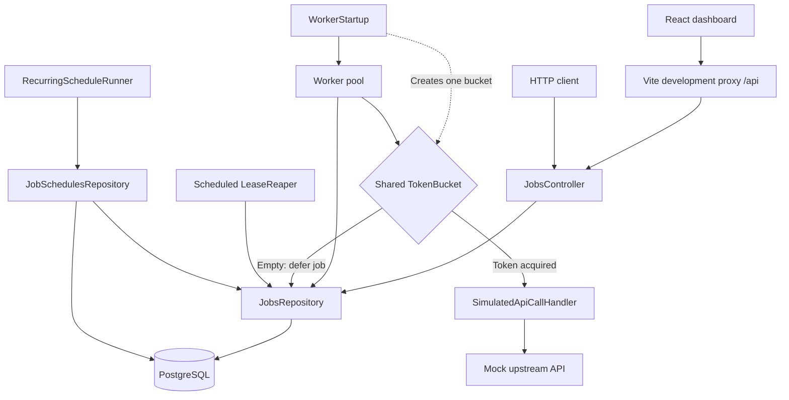
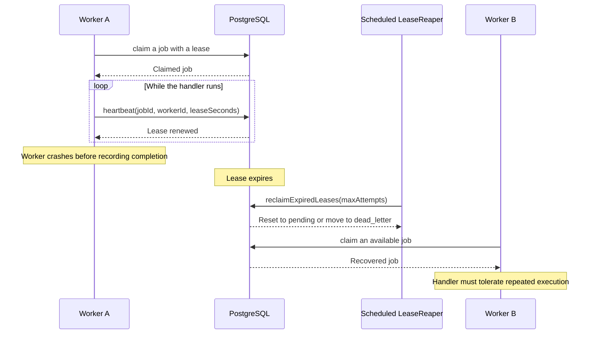
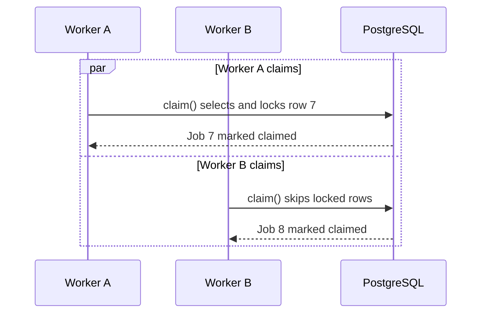
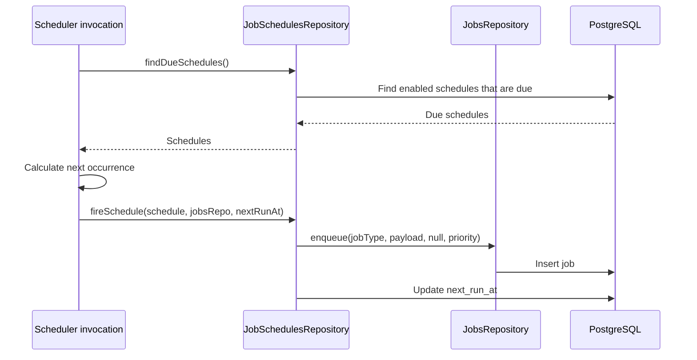
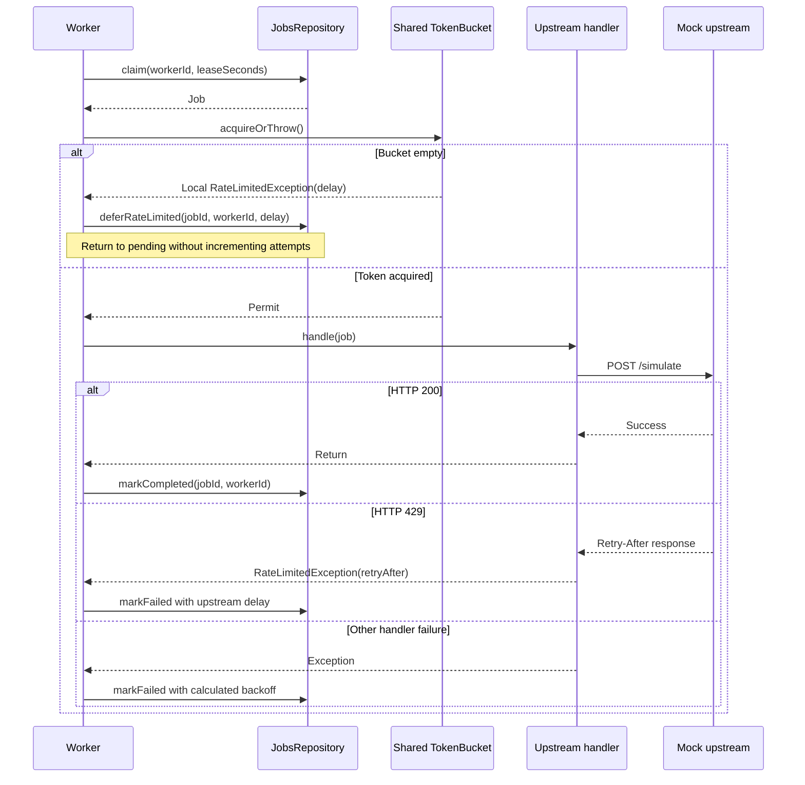
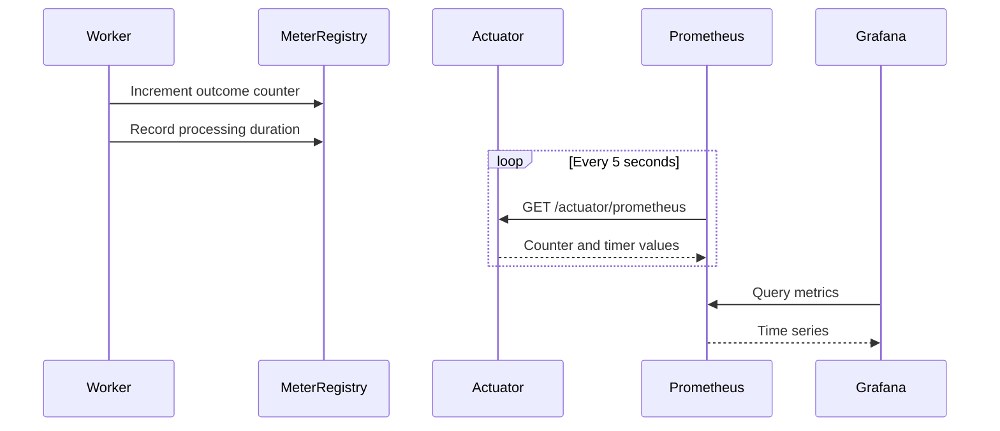
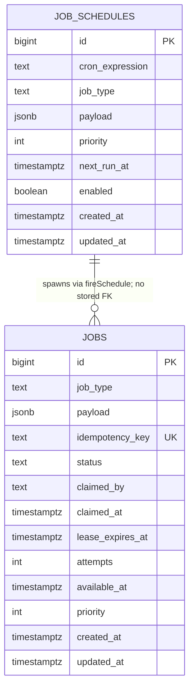

# Sluice

[](https://github.com/amanxsays/Sluice/actions/workflows/ci.yml)

A PostgreSQL-backed job scheduler and durable task queue, built in Java for rate-limited external API workloads such as LLM APIs and third-party services, with a React dashboard for submitting jobs and watching their progress.

Sluice combines proactive outbound rate limiting with reactive HTTP 429 handling. Workers share an in-memory Token Bucket before calling the upstream API, while real upstream rate-limit responses continue to use the existing `Retry-After` retry path.

The name comes from a sluice gate: it controls the rate at which work flows through.

> **Current version:** Backend `0.1.0-SNAPSHOT`; frontend `0.1.0`. Includes the queue engine, automatic heartbeats and lease recovery, recurring schedules, rate limiting, query API, atomic batch submissions, and a local React dashboard with an interactive Test lab. See [Running the tests](#running-the-tests) for validation and [Project status / roadmap](#project-status--roadmap) for remaining work.

Deploy PostgreSQL, the API, and the frontend independently with **Neon → Render → Netlify**. The backend has a built-in demo upstream, configurable CORS, and an environment-driven port/database connection. Follow [the deployment guide](DEPLOYMENT.md) for the exact setup order, environment variables, and verification steps.

---

## Table of contents

- [Why this exists](#why-this-exists)
- [Features](#features)
- [Architecture](#architecture)
- [How it works](#how-it-works)
  - [Job lifecycle](#job-lifecycle)
  - [Crash recovery: leases, heartbeats, and the reaper](#crash-recovery-leases-heartbeats-and-the-reaper)
  - [Concurrent claiming with `SKIP LOCKED`](#concurrent-claiming-with-skip-locked)
  - [Recurring schedules](#recurring-schedules)
  - [Autonomous job processing](#autonomous-job-processing)
  - [Proactive Token Bucket rate limiting](#proactive-token-bucket-rate-limiting)
  - [Observability: metrics, Prometheus, and Grafana](#observability-metrics-prometheus-and-grafana)
  - [Schema](#schema)
- [Tech stack](#tech-stack)
- [Running it locally](#running-it-locally)
- [Frontend dashboard](#frontend-dashboard)
- [Separate deployments](DEPLOYMENT.md)
- [HTTP API](#http-api)
- [Configuration](#configuration)
- [Running the tests](#running-the-tests)
- [Benchmark results](#benchmark-results)
- [Key design decisions](#key-design-decisions)
- [Project status / roadmap](#project-status--roadmap)

---

## Why this exists

Calling an external API becomes a queueing problem when requests must survive process failures, wait through provider rate limits, and retry without overwhelming the upstream service.

Sluice explores those concerns through a durable PostgreSQL queue:

- How can concurrent workers claim different jobs safely?
- How can unfinished work be recovered after a worker crashes?
- How should retries respect an upstream service's `Retry-After` response?
- How can workers proactively control outbound traffic before receiving a 429?
- How can local throttling defer work without exhausting its failure budget?

The queue is built directly on PostgreSQL. Job persistence, claiming, retry scheduling, and recovery primitives are implemented explicitly so their behavior can be inspected and tested.

Duplicate submission and duplicate execution are separate concerns. Sluice's enqueue idempotency keys prevent duplicate queue rows. Handlers still need appropriate idempotency for external side effects if a job executes more than once.

## Features

- **PostgreSQL-backed queue.** Job durability comes from the database.
- **Safe concurrent claiming.** Workers use `SELECT ... FOR UPDATE SKIP LOCKED` to claim available jobs without taking the same row.
- **Automatic crash recovery.** Workers renew active leases with periodic heartbeats; a scheduled reaper recovers expired claims or moves them to dead-letter when their failure budget is exhausted.
- **Retries with exponential backoff and full jitter.** General handler failures are rescheduled through the existing retry mechanism.
- **Dead-letter handling.** Jobs that exhaust their failure budget stop retrying automatically.
- **Idempotent enqueueing.** A database uniqueness constraint and `ON CONFLICT ... DO NOTHING` prevent duplicate submissions with the same idempotency key.
- **Priority-aware claiming.** Higher-priority jobs are selected before lower-priority jobs, followed by creation time.
- **Recurring schedules.** A scheduled runner polls due cron templates and creates ordinary jobs independently of previous executions.
- **Autonomous worker pool.** Configurable background workers start when `sluice-api` boots.
- **Proactive outbound rate limiting.** All `call-api` workers started by one application instance share a configurable in-memory Token Bucket.
- **Deferral without spending attempts.** An empty local bucket returns a job to `pending` with a future `available_at`, preserving its failed-attempt count.
- **Reactive HTTP 429 handling.** Actual upstream 429 responses retain their existing `Retry-After` scheduling behavior.
- **Live observability.** Micrometer counters and timers are exposed through Spring Boot Actuator, scraped by Prometheus, and available to Grafana.
- **Automated tests and CI.** Pure Java unit tests and PostgreSQL integration tests run through Maven and the GitHub Actions workflow.
- **One-command backend setup.** Docker Compose starts PostgreSQL, the API and workers, mock upstream, Prometheus, and Grafana. The frontend runs separately through Vite.
- **Benchmark harness.** Worker scaling can be measured against the mock upstream. Existing results are an unthrottled baseline.
- **HTTP job API.** Submit jobs, list and filter recent jobs, inspect individual jobs, and retrieve counts by status.
- **Live queue dashboard.** Submit success, slow, or deliberate-failure workloads; filter and paginate jobs; inspect all job fields; and follow real API data with automatic polling.
- **Atomic batch submissions.** Enqueue up to 100 jobs in one database transaction; optional numbered idempotency keys make batch resubmission safe.
- **Interactive Test lab.** Choose real worker threads, job counts, upstream latency, and a pause before claiming. Scenario-specific inputs, accessible ⓘ explanations, queue animations, worker slots, event logs, and measured pass/fail checks demonstrate seven queue behaviors.
- **Accessible, responsive frontend.** Keyboard-accessible job details, copy controls, visible focus states, mobile table scrolling, and connection errors that preserve previously loaded data.

## Architecture

Sluice has three Maven modules and a separate frontend:

| Module | Responsibility |
|---|---|
| `sluice-core` | Queue engine, repositories, worker loop, retry logic, token bucket, and metrics instrumentation |
| `sluice-api` | Spring Boot HTTP API, configuration, worker startup, lease reaper, and recurring-schedule runner |
| `mock-upstream` | Standalone HTTP service that simulates latency and HTTP 429 responses |
| `frontend/` | React/Vite queue console, API client, serialized polling, and ordinary CSS; built with npm rather than Maven |

Important components:

| Module | Component | Responsibility |
|---|---|---|
| `sluice-core` | `JobsRepository` | Queue mutations, ownership checks, paginated job queries, and status counts |
| `sluice-core` | `JobSchedulesRepository` | Find due schedules and create their job executions |
| `sluice-core` | `BackoffCalculator` | Exponential backoff with jitter |
| `sluice-core` | `CronScheduleCalculator` | Calculate the next cron occurrence |
| `sluice-core` | `Worker` | Claim work, renew its lease during execution, and complete, defer, retry, or record lease loss |
| `sluice-core` | `JobHandler` | Interface for job-specific work |
| `sluice-core` | `TokenBucket` | Thread-safe in-memory admission control for outbound calls |
| `sluice-core` | `SimulatedApiCallHandler` | Make HTTP calls to the mock upstream and interpret responses |
| `sluice-core` | `RateLimitedException` | Carry a retry delay and distinguish local throttling from upstream 429 |
| `sluice-api` | `JobsController` | Handle enqueue, filtered lists, per-job details, and status-count requests |
| `sluice-api` | `WorkerStartup` | Share one bucket across workers, assign instance-specific worker IDs, and stop workers on shutdown |
| `sluice-api` | `AppConfig` | Construct repositories and the cron calculator, and enable scheduled tasks |
| `sluice-api` | `LeaseReaper` | Periodically reclaim expired job leases |
| `sluice-api` | `RecurringScheduleRunner` | Poll due schedules, enqueue executions, and calculate the next occurrence |
| `mock-upstream` | `SimulateController` | Handle `POST /simulate` with configurable latency and 429 behavior |
| `frontend` | `src/lib/api.js` | Serialize submissions, consume API responses, and handle HTTP errors and cancellation |
| `frontend` | `useDashboard` / `createPoller` | Refresh jobs, counts, and open details without overlapping batches or applying stale responses |

Flyway migrations live in `sluice-core/src/main/resources/db/migration` and are available to `sluice-api` through its dependency on core.

The repository root also contains:

- `docker-compose.yml`
- `prometheus.yml`
- `.github/workflows/ci.yml`
- `sluice-benchmark-results.png`

### Module boundaries

`sluice-core` uses plain Java and JDBC and has no Spring dependency. Its repositories, token bucket, and workers can be tested without starting a Spring application context.

`sluice-api` supplies configuration, the `DataSource`, and the concrete `MeterRegistry`. `WorkerStartup` connects these components and creates the shared token bucket before starting worker threads.

`mock-upstream` is an optional independent Spring Boot application. The API now also provides `POST /simulate`, and its workers use that embedded endpoint through loopback HTTP by default. Set `SLUICE_MOCK_UPSTREAM_URL` to use the standalone service instead. Tests and benchmarks can exercise actual HTTP behavior without calling a paid external service.

`frontend/` is a separate npm project. During development, Vite proxies `/api/*` to the Java API and removes the `/api` prefix. Production hosting needs its own API routing.



The database coordinates job ownership. The token bucket coordinates outbound admission within the current application instance.

## How it works

### Job lifecycle

Jobs begin in `pending`, become `claimed` when a worker acquires them, and move to `completed` after successful handling.

An actual failure increments `attempts` and either schedules a retry or moves the job to `dead_letter`.

Local token-bucket rejection follows a separate path: the job returns to `pending` with a future availability time, but its attempt count does not change.

```mermaid
stateDiagram-v2
    [*] --> pending : enqueue()

    pending --> claimed : claim an available job

    claimed --> completed : handler succeeds

    claimed --> pending : local throttle; attempts unchanged
    claimed --> pending : failure; retry budget remains
    claimed --> pending : expired lease reclaimed; budget remains

    claimed --> dead_letter : failure budget exhausted
    claimed --> dead_letter : lease reclamation exhausts budget

    completed --> [*]
    dead_letter --> [*]
```



The existing claim query selects only jobs whose status is `pending` and whose `available_at` is due. Both ordinary retries and local rate-limit deferrals use this mechanism.

### Crash recovery: leases, heartbeats, and the reaper

A claimed job receives a lease deadline. The repository provides:

- `heartbeat(...)` to extend an owned job's lease.
- `reclaimExpiredLeases(...)` to release expired claims and account for failed attempts.

Each worker starts a heartbeat task for its claimed job while the handler runs. The interval is one-third of the configured lease duration, with a minimum of 100 ms: the default 30-second lease is renewed about every 10 seconds. Heartbeats stop before the worker records the processing outcome.

`LeaseReaper` automatically invokes `reclaimExpiredLeases(maxAttempts)` with a default fixed delay of three seconds. Recovery increments the recorded failure count and either returns the job to `pending` or moves it to `dead_letter`. A healthy long-running job is protected by its heartbeat renewals.

The worker checks lease ownership before acknowledging the outcome. Rejected heartbeat or outcome updates are recorded as `lease_lost`. A failed database heartbeat is logged, and later heartbeat attempts continue.



Recovery can repeat work if the upstream side effect succeeded before the worker crashed. Enqueue idempotency keys do not, by themselves, prevent repeated external side effects.

### Concurrent claiming with `SKIP LOCKED`

The claim operation selects an eligible job and updates its ownership in one SQL statement.

`FOR UPDATE SKIP LOCKED` allows another worker to skip a row that is already locked and claim another eligible job instead of waiting for that row.



An existing concurrency test runs four threads against 20 seeded jobs and verifies that every claimed job ID is unique.

### Recurring schedules

A row in `job_schedules` is a template for future executions. Firing a schedule creates an ordinary job through the enqueue path and advances the schedule's next occurrence.

The spawned job's success or failure is separate from the schedule's future occurrences.



`RecurringScheduleRunner` invokes this flow automatically with a default fixed delay of two seconds. Cron expressions use the five-field UNIX format and are evaluated in UTC. The next occurrence is calculated from the current time, so missed occurrences are not replayed individually.

Schedules currently live in the database; there is no schedule-management HTTP API or dashboard. Enqueueing a scheduled job and advancing `next_run_at` use separate database operations, without a shared transaction or distributed schedule lock. Multiple application instances can therefore enqueue duplicate occurrences.

### Autonomous job processing

Each `Worker` runs on a background thread started by `WorkerStartup`.

Worker IDs include an application-instance UUID. Shutdown requests stop the workers and interrupt their threads; exiting worker loops close their heartbeat executors.

`processOnce()` performs one claim-and-handle cycle. `run()` repeatedly invokes it. When no eligible job is available, the existing loop sleeps for two seconds before polling again.

For `call-api` jobs, the registered handler first checks the shared bucket and then invokes `SimulatedApiCallHandler`.



A `true` result from `processOnce()` means a job was claimed and processed through one of these paths. It does not necessarily mean that the job completed successfully.

### Proactive Token Bucket rate limiting

The limiter controls outbound API-call admission before workers invoke the upstream handler.

It supports:

- Configurable capacity.
- Configurable refill rate per second.
- Controlled bursts.
- Fractional token refill.
- Thread-safe acquisition.
- Monotonic elapsed-time calculation using `System.nanoTime()`.
- Rescheduling when empty without waiting for token refill.

#### One bucket shared by the worker pool

`WorkerStartup.run()` creates the bucket and handler wrapper before entering the worker creation loop:

```java
TokenBucket bucket = new TokenBucket(bucketCapacity, refillPerSecond);
JobHandler upstreamHandler = new SimulatedApiCallHandler(mockUpstreamUrl);

JobHandler limitedHandler = job -> {
    bucket.acquireOrThrow();
    upstreamHandler.handle(job);
};

Map<String, JobHandler> handlers = Map.of("call-api", limitedHandler);
```

Every worker receives the same handler map. The wrapper captures the same bucket instance, so adding worker threads does not create additional independent allowances.

If acquisition throws, execution never reaches `upstreamHandler.handle(job)`.

#### Refill and acquisition

The bucket starts full. On each acquisition attempt, it calculates the tokens earned since its previous accounting update:

```text
availableTokens = min(
    capacity,
    availableTokens + elapsedSeconds * refillPerSecond
)
```

There is no scheduled refill task. Tokens are replenished lazily when acquisition is attempted.

Refill, checking, and consumption occur inside one synchronized method. HTTP execution happens after this method releases its lock.

One successful acquisition consumes one token. Tokens represent API-call permits, not LLM input or output tokens.

#### Deferral when empty

When fewer than one token is available, the bucket calculates a retry delay from the missing token balance and refill rate.

The existing queue schedules retries in whole seconds, so the delay rounds upward and is at least one second.

`RateLimitedException.localThrottle(delay)` identifies a local admission rejection. `Worker` routes it to:

```java
jobsRepository.deferRateLimited(job.id(), workerId, delay);
```

The database update:

- Returns the job to `pending`.
- Sets a future `available_at`.
- Clears `claimed_by`, `claimed_at`, and `lease_expires_at`.
- Updates `updated_at`.
- Preserves `attempts`.
- Applies only if the specified worker still owns a job in `claimed` state.

This prevents a healthy job from exhausting its failure budget merely because other jobs consumed the available tokens.

The worker does not sleep for the token delay. It can immediately process other eligible work.

#### Proactive and reactive behavior

| Situation | Scheduling behavior | Failed attempts |
|---|---|---|
| Token available, handler succeeds | Mark completed | Unchanged |
| Local bucket empty | Defer using `available_at` | Unchanged |
| Actual upstream HTTP 429 | Existing `Retry-After` retry path | Incremented |
| Other handler exception | Existing backoff calculation | Incremented |

The existing `RateLimitedException(int retryAfterSeconds)` constructor continues to represent an upstream rate-limit response.

`SimulatedApiCallHandler` still expects an integer-seconds `Retry-After` header and falls back to one second when the header is absent. HTTP-date values are not currently supported.

#### Scope and limitations

- **Single application instance:** workers started by one `WorkerStartup` share one bucket. Another JVM would have an independent allowance.
- **In-memory state:** restarting the application creates a fresh, full bucket.
- **One shared allowance:** all wrapped `call-api` jobs use the same bucket; there are no separate per-tenant or per-provider buckets.
- **Whole-second deferrals:** retry scheduling is coarser than the bucket's elapsed-time accounting.
- **Polling affects throughput:** the existing idle polling interval can add further delay.
- **No future reservation:** a deferred job must acquire a token again when it becomes eligible.
- **No token refund:** a consumed token remains consumed if the handler later fails.
- **Rate and concurrency differ:** bucket settings control admission rate; worker count controls concurrent execution.
- **Reactive 429 remains per job:** a 429 reschedules that job; it does not change the bucket's refill rate or impose a shared cooldown.

A globally coordinated limiter for multiple application instances remains future work.

### Observability: metrics, Prometheus, and Grafana

`Worker` records metrics through Micrometer in `sluice-core`.

The counter `sluice.worker.jobs` uses these outcome tags:

| Outcome | Meaning |
|---|---|
| `completed` | The handler returned successfully and the owned job was marked completed |
| `failed` | An upstream 429 or another handler exception was successfully recorded through the failure path |
| `deferred` | A locally throttled job was successfully rescheduled without consuming an attempt |
| `no_handler` | No handler was registered for the job type |
| `lease_lost` | The worker could not acknowledge an outcome because it no longer owned the claim |

These are processing counters, not a count of unique submissions. A missing handler records `no_handler` and then follows the general failure path; a successful failure update also records `failed`. Queue counts displayed in the React dashboard come from `/jobs/stats`, independently of these metrics.

`sluice.worker.job.duration` measures the timed handler/completion block after a claim. It also records attempts rejected by the local bucket. It does not measure the job's total waiting time in the queue.

`sluice-api` supplies the concrete `MeterRegistry` and exposes metrics at `/actuator/prometheus`. Prometheus scrapes this endpoint every five seconds, and Grafana queries the stored series.



Example PromQL for completed processing rate:

```promql
sum(rate(sluice_worker_jobs_total{outcome="completed"}[1m]))
```

Example PromQL for local deferral rate:

```promql
sum(rate(sluice_worker_jobs_total{outcome="deferred"}[1m]))
```

Tests and the benchmark harness use `SimpleMeterRegistry`, so worker instrumentation can be exercised without running Prometheus.

### Schema



`status` is `TEXT` with a `CHECK` constraint allowing `pending`, `claimed`, `completed`, `failed`, and `dead_letter`.

The worker's retry paths use `pending` and `dead_letter`; local deferral uses `pending`.

The Token Bucket feature requires no schema migration. It reuses the existing claim, availability, and attempt-tracking columns.

## Tech stack

| Component | Technology |
|---|---|
| Language | Java 21 |
| Web framework | Spring Boot 4.1.1 |
| Frontend | React 19, Vite 8, JavaScript, and ordinary CSS |
| Frontend tooling | ESLint and Node's built-in test runner |
| Database access | Plain JDBC in `sluice-core` |
| Database | PostgreSQL 16 |
| Migrations | Flyway |
| Outbound HTTP | Java's built-in `java.net.http.HttpClient` |
| Proactive rate limiting | In-memory Token Bucket using `System.nanoTime()` and synchronized acquisition |
| Metrics | [Micrometer](https://micrometer.io/) and Spring Boot Actuator |
| Metrics storage and dashboards | Prometheus and Grafana |
| CI | GitHub Actions |
| Testing | JUnit Jupiter, Testcontainers, controllable-clock unit tests, and a local HTTP test server |
| Cron parsing | [cron-utils](https://github.com/jmrozanec/cron-utils) |
| Containerization | Docker and Docker Compose with multi-stage builds |

## Running it locally

### Full stack with Docker Compose

From the repository root:

```bash
docker compose up --build
```

This builds the Java services from source and starts the backend and observability stack:

| Service | Host port |
|---|---|
| PostgreSQL | `5432` |
| Sluice API | `8080` |
| Mock upstream | `8081` |
| Prometheus | `9090` |
| Grafana | `3000` |

PostgreSQL has a health check, and the API waits for it to become healthy.

The React dashboard is started separately on port `5173`; see [Frontend dashboard](#frontend-dashboard).

Enqueue a job:

```bash
curl -X POST http://localhost:8080/jobs \
  -H "Content-Type: application/json" \
  -d '{"jobType":"call-api","payload":"{\"latencyMs\":200,\"shouldFail\":false,\"retryAfterSeconds\":0}","idempotencyKey":null,"priority":0}'
```

A background worker claims the job when it is eligible. If the shared bucket permits the call, the worker invokes mock upstream and completes the job on success. If the bucket is empty, the worker defers the job.

Completion time depends on queue load, token availability, polling, and upstream latency.

To exercise reactive HTTP 429 handling:

```bash
curl -X POST http://localhost:8080/jobs \
  -H "Content-Type: application/json" \
  -d '{"jobType":"call-api","payload":"{\"latencyMs\":0,\"shouldFail\":true,\"retryAfterSeconds\":7}","idempotencyKey":null,"priority":0}'
```

When admitted by the bucket, this job receives a 429 from mock upstream and follows the existing seven-second retry path. Because its payload keeps requesting failure, later admitted attempts also fail until the configured attempt budget is exhausted.

### Observe the application

- Prometheus targets: `http://localhost:9090/targets`
- Grafana: `http://localhost:3000`
- Application metrics: `http://localhost:8080/actuator/prometheus`

For a fresh Grafana instance, the default credentials are `admin` / `admin`. Add Prometheus as a data source using `http://prometheus:9090`.

Useful series include:

- `sluice_worker_jobs_total`
- `sluice_worker_job_duration_seconds_sum`
- `sluice_worker_job_duration_seconds_count`

Filter the outcome counter by `deferred` to observe local throttling separately from failures.

### Run the Java services with Maven

For local development, use JDK 21 and Maven, with Docker available for PostgreSQL and integration tests.

Start PostgreSQL and build the project:

```bash
docker compose up -d postgres
mvn install
```

Start the API and workers:

```bash
mvn -pl sluice-api spring-boot:run
```

The default configuration uses PostgreSQL at `localhost:5432` and the API's embedded upstream at `http://127.0.0.1:8080/simulate`. Starting `mock-upstream` is optional; benchmarks that target its original port still need it.

## Frontend dashboard

The dark React/Vite queue console lives in [`frontend/`](frontend/README.md). Queue and Test lab have separate views. It uses real API data to show job counts, filter and paginate jobs, submit workloads, and inspect live details. Data refreshes about every three seconds; request failures preserve the last successful data.

- **Queue:** total, pending, claimed, completed, and dead-letter counts across all jobs. Click a status card to filter the jobs table; use Refresh for an immediate update.
- **Jobs:** newest-first rows, status filters, page sizes of 10/25/50/100, and limit/offset pagination. Changing the filter or page size resets to the first page; global totals are not treated as filtered result counts.
- **Submission:** choose a preset and job count. **Advanced options** contains the job type, validated JSON editor, and optional idempotency key. Duplicate submission is disabled while a request is pending.
- **Batch submission:** choose 1/5/10/20/40 jobs; batches are committed together. A supplied idempotency prefix creates keys `prefix:1`, `prefix:2`, and so on.
- **Test lab:** the sidebar's **Tests** dropdown opens the chosen scenario in its own view. Hover, focus, or tap the circled **i** for an explanation. Dedicated test workers use the selected thread count; animations follow actual database state and events. Expand **Event log** or **Verification details** when needed.
- **Inspector:** current status, attempts, dates, formatted payload, and copy buttons. Expand **Worker & lease details** for claim metadata and idempotency. Escape closes the dialog and returns keyboard focus.
- **Live updates:** one polling batch at a time; requests from old filters are cancelled or ignored, while form input, focus, selected job, and previously loaded data survive refreshes.

Start PostgreSQL and the API from the repository root:

```bash
docker compose up --build -d postgres sluice-api
```

Then, with Node.js 20.19+, 22.13+, or 24+ on the supported major-version lines:

```bash
cd frontend
npm ci
npm run dev
```

Open the local URL printed by Vite (normally `http://localhost:5173`). Choose **Slow job**, submit it, and open its details to watch it move through the queue. The **Failure** preset deliberately returns upstream HTTP 429 on every attempt and eventually reaches `dead_letter` after the configured failure budget is exhausted. An idempotency key returns the original job when reused.

```bash
npm run lint
npm test
npm run build
```

The production assets are written to `frontend/dist/`. `VITE_API_BASE_URL` defaults to `/api` for local development. Vite's development proxy forwards `/api/*` to `http://localhost:8080/*`. For separate hosting, set `VITE_API_BASE_URL=https://YOUR_BACKEND.onrender.com` in the frontend build environment and `SLUICE_CORS_ALLOWED_ORIGINS=https://YOUR_FRONTEND.netlify.app` on the backend. The repository includes `netlify.toml`, `render.yaml`, and backend/frontend environment templates; follow [DEPLOYMENT.md](DEPLOYMENT.md). Building or previewing the frontend does not publish it or start the backend.

`npm run preview` serves the production build locally for visual checks and does not provide the development API proxy. The dashboard has no login, schedule-management controls, or manual retry action for ordinary jobs.

### Using the Test lab

1. Expand **Tests** in the sidebar and select **Batch & queue**.
2. Choose **10 jobs**, **2 worker threads**, **3 seconds** upstream latency, and **1 second** pause before claiming.
3. Click **Run batch & queue**. Pending jobs appear first; at most two are claimed at once. Each thread pauses before claiming its next job, making the states easier to follow.
4. Click any animated job card to open its live details. Worker slots show current ownership; expand **Event log** to see claims and acknowledgements.
5. Read the pass/fail result; expand **Verification details** for measured checks. Choose another scenario to change its controls. The previous report stays visible until another run starts.

| Test | Inputs specific to the scenario | Visualization and evidence |
|---|---|---|
| More jobs than workers | Batch size, thread count, latency, claim pause | Pending → claimed → completed lanes; worker ownership; observed pending/claimed overlap and concurrency limit |
| Idempotency | Concurrent submission count, processing threads, latency, claim pause | Many returned IDs merge into one persisted job; actual concurrent inserts use the same unique key |
| Concurrency / SKIP LOCKED | More jobs than at least two workers, latency, claim pause | First row held in a separate transaction; other claims bypass it; lock releases; every job claimed once |
| Lease expiry & recovery | Initial lease, recovery latency, claim pause | Abandoned lease countdown → scheduled reaper → pending → recovery worker; one recovery attempt |
| Heartbeat / lease renewal | Initial lease, latency longer than that lease, claim pause | Lease ring and successful renewal pulses; one claim, multiple heartbeats, zero failed attempts |
| Retries & dead letter | Failure budget, Retry-After delay, latency, claim pause | Attempt rail and backoff countdown; actual upstream HTTP 429 responses exhaust the budget |
| Local rate limiting | Batch size, threads, latency, claim pause | Shared capacity-one bucket at one token/second; deferral chips and queue return; zero failed attempts |

The lab polls every 600 ms without overlapping requests; the main dashboard keeps its three-second polling interval. Processing bars indicate worker activity rather than a guessed completion percentage. Test jobs use reserved types `sluice-lab:<run UUID>`: ordinary workers skip them, and each lab worker can claim only its own run. Ordinary application worker configuration stays in `application.yml`.

One lab run is allowed at a time per API instance, with at most 40 jobs/submissions and eight worker threads. Tests have a three-minute deadline and a 15-second upstream request timeout. Up to 20 reports and 2,000 events per report remain in memory; jobs stay in PostgreSQL and global dashboard totals include them. API restart loses reports and stops active lab workers; incomplete reserved lab jobs remain in the database and ordinary workers do not process them. The lab is intended for the local workspace. Disable its endpoints with `sluice.lab.enabled=false` (`SLUICE_LAB_ENABLED=false`).

## HTTP API

The Java API runs at `http://localhost:8080`. The dashboard uses the same endpoints through its `/api` development proxy.

| Method | Endpoint | Response |
|---|---|---|
| `POST` | `/jobs` | The newly enqueued job, or the original job for a reused idempotency key |
| `POST` | `/jobs/batch` | JSON array of jobs committed together; request adds `count` (1–100) to the enqueue body |
| `GET` | `/jobs?limit=50&offset=0` | A JSON array ordered by ID descending; optional `status` filter |
| `GET` | `/jobs/{id}` | One job, or HTTP 404 when absent |
| `GET` | `/jobs/stats` | Counts named `total`, `pending`, `claimed`, `completed`, and `dead_letter` across all jobs |
| `POST` | `/tests/runs` | Start a real Test lab scenario; HTTP 400 for invalid inputs, 409 while another run is active |
| `GET` | `/tests/runs/current` | Latest/current report, or an empty response if no run has started |
| `GET` | `/tests/runs/{id}` | Report with jobs, events, options, peak claimed count, renewals, and checks; 404 if expired or lost on restart |
| `GET` | `/actuator/prometheus` | Micrometer metrics in Prometheus format |
| `GET` | `/actuator/health` | Readiness, including database connectivity; Render health-check endpoint |
| `POST` | `/simulate?latencyMs=100&shouldFail=false&retryAfterSeconds=1` | Embedded demo upstream: HTTP 200 or 429 with Retry-After; optional via `SLUICE_SIMULATION_ENABLED` |

Job-list filters accept `pending`, `claimed`, `completed`, and `dead_letter`. An omitted or blank status means all statuses. The limit must be 1–100 and the offset must be nonnegative; invalid query parameters return HTTP 400. The list response is an array, not a pagination envelope or PowerShell `value`/`Count` wrapper.

Example submission body:

```json
{
  "jobType": "call-api",
  "payload": "{\"latencyMs\":100,\"shouldFail\":false,\"retryAfterSeconds\":1}",
  "idempotencyKey": null,
  "priority": 0
}
```

`payload` must be a **string containing valid JSON**, rather than a nested object. Include `priority: 0`: `EnqueueRequest` contains a primitive `int priority`, and the current JSON mapper rejects an omitted value. The controller currently enqueues at priority zero regardless of the requested value; repository-level and recurring-schedule priorities still affect claiming.

The runtime registers the `call-api` handler, whose payload uses `latencyMs`, `shouldFail`, and `retryAfterSeconds`. Unsupported job types enter the missing-handler failure path.

Batch bodies use the same string payload and `priority: 0`, plus `count`. Their `idempotencyKey`, if supplied, is a numbered prefix: reuse the same prefix **and count** to retrieve the same batch. A changed prefix creates new jobs; a larger count extends a reused prefix with additional jobs. The `sluice-lab:` job-type namespace is reserved and rejected by ordinary submission endpoints.

Example lab request (`POST /tests/runs`):

```json
{
  "scenario": "batch",
  "jobCount": 10,
  "workerCount": 2,
  "latencyMs": 3000,
  "claimDelayMs": 1000,
  "leaseSeconds": 2,
  "maxAttempts": 3,
  "retryAfterSeconds": 2
}
```

Supported scenario IDs: `batch`, `idempotency`, `locking`, `lease-expiry`, `heartbeat`, `retry`, `rate-limit`. Include all option fields, even those hidden by a scenario's form. Heartbeat, expiry, and retry use one job and one worker; locking requires at least two workers and more jobs than threads; heartbeat latency must exceed the lease by more than one second.

Job responses contain `id`, `jobType`, `payload`, `idempotencyKey`, `status`, `claimedBy`, `claimedAt`, `createdAt`, `updatedAt`, `leaseExpiresAt`, `attempts`, `availableAt`, and `priority`. Payloads remain JSON strings, dates are timestamps, and claim or scheduling fields may be null.

`attempts` counts recorded failures and expired-lease recoveries, not every execution or local throttle. A completed job can have nonzero attempts. Claim metadata may remain after completion, so status determines the current state. `pending` includes both jobs ready to run and jobs waiting for a future `availableAt`. Although the schema also permits `failed`, current worker retry paths use `pending` and `dead_letter`; the API's filters and named status counts cover those active lifecycle states.

## Configuration

The worker and limiter settings are in:

```text
sluice-api/src/main/resources/application.yml
```

Current defaults:

```yaml
sluice:
  lab:
    enabled: true
  rate-limit:
    capacity: 10
    refill-per-second: 5.0
  worker:
    count: 2
    lease-seconds: 30
    max-attempts: 5
  scheduler:
    poll-delay-ms: 2000
  reaper:
    poll-delay-ms: 3000
  mock-upstream:
    url: http://127.0.0.1:8080/simulate
```

| Property | Default | Meaning |
|---|---:|---|
| `sluice.rate-limit.capacity` | `10` | Maximum accumulated tokens and initial burst allowance |
| `sluice.rate-limit.refill-per-second` | `5.0` | Tokens replenished per second |
| `sluice.worker.count` | `2` | Background worker threads started by the application |
| `sluice.worker.lease-seconds` | `30` | Claim lease duration; also used for heartbeat renewal |
| `sluice.worker.max-attempts` | `5` | Failed-attempt budget before dead-lettering |
| `sluice.scheduler.poll-delay-ms` | `2000` | Fixed delay between recurring-schedule polling runs |
| `sluice.reaper.poll-delay-ms` | `3000` | Fixed delay between expired-lease recovery runs |
| `sluice.lab.enabled` | `true` | Enable the local Test lab service and endpoints |
| `sluice.mock-upstream.url` | `http://127.0.0.1:<server.port>/simulate` | Embedded upstream; override with `SLUICE_MOCK_UPSTREAM_URL` for a standalone service |
| `server.port` | `${PORT:8080}` | Hosting port, with `8080` as the local default |
| `sluice.cors.allowed-origins` | Local Vite origins | Comma-separated exact frontend origins; configure with `SLUICE_CORS_ALLOWED_ORIGINS` |
| `sluice.simulation.enabled` | `true` | Enable the embedded demo endpoint; configure with `SLUICE_SIMULATION_ENABLED` |
| `spring.datasource.hikari.maximum-pool-size` | `5` | Database pool size; configure with `DB_POOL_SIZE` |

Capacity must be at least one. The refill rate must be positive and finite. Invalid limiter settings fail during worker startup.

A fractional refill rate is supported. For example, `0.5` replenishes one token every two seconds.

The default bucket begins with 10 tokens and replenishes five per second. It allows controlled bursts; it does not enforce a strict fixed-window limit of five calls in every calendar second.

Docker Compose overrides the database and upstream addresses to use container networking. Rebuild the application image after changing source-controlled configuration when using the full Compose setup.

## Running the tests

Recorded validation for the current implementation:

```text
Java reactor:      50 tests (39 core + 11 API), 0 failures, 0 errors, 0 skipped
Frontend suite:    17 tests, 0 failures, 0 skipped
Frontend lint:    passed
Production build: passed
```

The full Maven test reactor and frontend checks were run on October 11, 2026 during the Test lab implementation. PostgreSQL behavior was checked with Testcontainers, and every lab scenario also completed against the running Docker stack through the browser.

Deployment preparation additionally reran the full Java suite and added three web integration tests for hosted-frontend CORS/preflight, rejected origins, and the embedded success/429 simulation. The API Docker build and frontend build with a separate API origin were verified; see [DEPLOYMENT.md](DEPLOYMENT.md).

The dark interface was verified against an isolated Docker API/database: ordinary and batch submissions, clickable status filters, expandable settings, job inspection, all seven live test scenarios, and preservation of form inputs across views. Automated WCAG 2 A/AA scans found no violations across queue, inspector, tooltip, scenario, and responsive states at 320/390/768/1024/1440 pixels.

Run the core suite:

```bash
mvn -pl sluice-core test
```

Run the full Maven reactor's tests:

```bash
mvn test
```

The PostgreSQL integration tests require a running Docker daemon because they use Testcontainers.

### Pure logic tests

`BackoffCalculatorTest`, `CronScheduleCalculatorTest`, and `TokenBucketTest` do not require Docker.

Run the bucket tests independently:

```bash
mvn -pl sluice-core -Dtest=TokenBucketTest test
```

`TokenBucketTest` verifies:

- Initial burst admission up to capacity.
- Rejection when empty.
- Local-throttle identification and upward rounding of retry delays.
- Fractional refill after elapsed time.
- Capacity enforcement after a long idle period.
- Rejection of invalid configuration.

A controllable clock makes refill tests deterministic without sleeping.

### Worker integration tests

Run:

```bash
mvn -pl sluice-core -Dtest=WorkerTest test
```

The worker tests retain the existing empty-queue, successful-processing, and missing-handler coverage.

Rate-limit integration coverage includes:

| Test | What it verifies |
|---|---|
| `processOnceUsesRetryAfterOnRateLimit` | An actual HTTP 429 with `Retry-After: 7` schedules the job using seven seconds and increments its failed-attempt count |
| `missingRetryAfterStillDefaultsToOneSecond` | A 429 without the header retains the existing one-second fallback |
| `concurrentWorkersShareBucketAndDeferWithoutSpendingAttempts` | Eight workers share a three-token bucket; three jobs complete and five are deferred without spending attempts |
| `localDeferralRequiresCurrentClaimOwner` | Another worker cannot defer an owned claim, and an already-deferred job cannot be deferred again through that claim |
| `heartbeatProtectsLongRunningJobFromReaper` | A 4.5-second handler with a two-second lease completes without being reclaimed or spending an attempt |

The concurrency test uses `maxAttempts = 1`, so accidentally treating local throttling as a failed attempt would immediately expose the error through dead-lettering.

The HTTP regression tests create their own local HTTP server and exercise the real `SimulatedApiCallHandler`. They no longer depend on a separately running mock-upstream application or skip when that application is absent.

### Test lab and batch integration tests

`JobsLabConcurrencyTest` launches 16 simultaneous claims while holding the first job's row lock in a separate transaction. It verifies distinct claims before unlock, isolation between two lab runs, exclusion from ordinary workers, and successful claiming of the skipped job after unlock. It also covers atomic batches, batch idempotency, and rollback for invalid JSON.

`TestLabServiceTest` runs all seven scenarios with real PostgreSQL, real `Worker` instances, a local HTTP upstream, and the actual scheduled-reaper implementation. Forty concurrent duplicate submissions run against a three-connection pool to catch connection starvation. Tests verify the measured checks, thread limits, isolation from ordinary jobs, heartbeat renewals, recovery attempts, input validation, and rejection of overlapping runs.

```bash
mvn -pl sluice-api -am -Dtest=JobsLabConcurrencyTest,TestLabServiceTest -Dsurefire.failIfNoSpecifiedTests=false test
```

### Dashboard queries and frontend verification

`JobsDashboardQueriesTest` verifies newest-first ordering, status filtering, limit/offset pagination, zero counts for an empty queue, and aggregate counts across the four lifecycle states.

```bash
mvn -pl sluice-core -Dtest=JobsDashboardQueriesTest test
cd frontend
npm run lint
npm test
npm run build
```

The frontend's 17 focused tests use Node's built-in runner and require no Docker. They cover payload serialization, idempotency keys, direct array responses, status counts, HTTP 400/404/server errors, network failures, request timeouts, cancellation, safe payload formatting, and polling concurrency and cleanup.

Live Chrome verification on October 11, 2026 exercised real job submission, completion, a slow job's claimed state, repeated 429 failures reaching dead-letter, idempotency, filters, pagination, copy controls, keyboard focus, live detail updates, and form preservation. Network failure and details-404 responses were injected for error-handling checks; successful job data came from the real backend. A delayed real response was also used to verify that a newer filter cannot be overwritten by an older response. Test lab verification additionally exercised all seven live scenarios, dynamic forms, tooltip hover/focus/Escape, reopening the current report after page reload, job inspection from animated cards, and idempotent ordinary batch resubmission.

Responsive browser checks covered 390, 768, 1024, and 1440 px widths. Automated axe-core scans reported no WCAG A/AA violations on the desktop dashboard, mobile dashboard, or details dialog; automated scans do not replace a full manual accessibility audit.

The GitHub Actions workflow currently runs **Maven tests** on pushes and pull requests targeting `master`. Frontend lint, tests, builds, and browser checks are run separately; they are not yet part of that workflow.

## Benchmark results

**These results are the existing unthrottled worker-scaling baseline.**

`BenchmarkRunner` constructs `SimulatedApiCallHandler` directly. It does not use the token-bucket wrapper created by `WorkerStartup`, so the table below does not measure the application's new default five-token-per-second configuration.

To benchmark rate-limited execution, the benchmark must use the same shared-bucket wrapper and record the capacity and refill rate used. No new limiter-enabled benchmark results are claimed here.

The baseline enqueued 100 jobs per phase, each with 50 ms of simulated upstream latency, against a real running mock-upstream instance. Worker count increased from one to eight.

The API application's own workers were stopped during the benchmark so they did not compete with the benchmark workers.

| Workers | Throughput (jobs/sec) | p95 latency (ms) |
|---|---:|---:|
| 1 | 9.23 | 10,203 |
| 2 | 18.14 | 4,834 |
| 4 | 32.49 | 2,610 |
| 8 | 44.84 | 1,915 |


Throughput increased approximately 4.9 times from one to eight workers, while p95 latency fell from over 10 seconds to under two seconds.

Scaling was not linear. Workers shared one PostgreSQL instance and one mock-upstream instance, and the benchmark harness used unpooled JDBC connections. These constraints affect the observed scaling.

Benchmark source:

```text
sluice-core/src/test/java/dev/sluice/core/BenchmarkRunner.java
```

## Key design decisions

- **Atomic claiming with `SKIP LOCKED`.** Workers skip rows locked by another claimant and can select other eligible jobs.
- **Leases and explicit recovery primitives.** A deadline makes abandoned claims detectable even when a worker cannot run cleanup code.
- **At-least-once recovery semantics.** Recovered jobs may execute again. Enqueue deduplication and handler-side idempotency address different parts of that problem.
- **Sequential identity primary keys.** Database-generated numeric IDs fit the queue's append-heavy workload.
- **`TEXT` status with a `CHECK` constraint.** Allowed states are controlled through schema migrations without introducing a PostgreSQL enum mapping.
- **Database-enforced enqueue idempotency.** `ON CONFLICT (idempotency_key) DO NOTHING` handles competing submissions atomically.
- **Recurring schedules separate from executions.** An individual job failure does not end future occurrences of its schedule.
- **`processOnce()` separate from `run()`.** A single processing cycle can be tested directly while the production loop handles repeated polling.
- **One shared Token Bucket per application instance.** Creating the bucket before the worker loop gives every wrapped worker the same allowance.
- **Monotonic, lazy refill.** `System.nanoTime()` supplies elapsed time, and acquisition calculates refill without a timer thread.
- **A small synchronized accounting section.** Refill and consumption are atomic; HTTP execution occurs outside the bucket lock.
- **Local deferral separate from actual failure.** Token scarcity does not consume attempts or send an otherwise healthy job to the dead-letter queue.
- **Reuse of `RateLimitedException`.** The existing upstream constructor remains valid, while a local-throttle flag selects the new deferral path.
- **Existing PostgreSQL scheduling for denied admissions.** A future `available_at` releases the worker to process other work.
- **Self-contained HTTP regression tests.** A local HTTP server verifies 429 handling without depending on a separately started service.
- **Framework-independent metrics in core.** Micrometer instrumentation stays with the worker; Spring supplies the runtime registry.
- **Multi-stage Docker builds.** Maven builds the application, and the runtime image contains the packaged application and JRE.
- **Serialized frontend polling.** The dashboard uses the existing HTTP endpoints and cancels stale queries instead of adding a realtime backend protocol.
- **Current state separated from processing metrics.** Dashboard cards count database rows; worker counters describe processing outcomes, including retries and local deferrals.

## Project status / roadmap

- [x] **Week 1:** Schema, Flyway migrations, enqueue endpoint, concurrent claiming, and concurrency tests.
- [x] **Week 2 — repository primitives:** Leases, heartbeat updates, expired-lease reclamation, backoff, jitter, and dead-letter handling.
- [x] **Week 3 — core logic:** Enqueue idempotency, priority-aware claiming, recurring schedule repositories, and cron calculation.
- [x] **Recovery integration:** Scheduled lease reclamation and periodic heartbeats for active long-running jobs.
- [x] **Recurring schedule integration:** Automatic polling, execution enqueueing, and calculation of the next cron occurrence.
- [x] **Week 4:** Autonomous workers, the HTTP upstream handler, reactive 429 handling, mock upstream, Docker Compose, and the baseline worker-scaling benchmark.
- [x] **Week 5:** Micrometer instrumentation, Actuator metrics, Prometheus, Grafana, and GitHub Actions testing.
- [x] **Proactive rate limiting:** One configurable in-memory Token Bucket shared by the current application's `call-api` workers.
- [x] **Attempt-preserving deferral:** Locally throttled jobs return to pending without consuming their failure budget.
- [x] **Rate-limit regression coverage:** Deterministic bucket tests, concurrent worker integration, claim ownership checks, and self-contained HTTP 429 tests.
- [x] **Job-query API:** Paginated, filtered lists, per-job details, and aggregate status counts with repository integration coverage.
- [x] **Frontend dashboard:** React/Vite console with real submissions, workload presets, live counts, pagination, job inspection, connection recovery, and responsive keyboard-accessible controls.
- [x] **Atomic batches:** Transactional enqueueing with numbered idempotency prefixes and rollback coverage.
- [x] **Interactive Test lab:** Seven real scenarios with dedicated worker threads, changing inputs, ⓘ explanations, live queue and scenario animations, worker ownership, event history, and measured results.
- [x] **Independent deployments:** Netlify/Render configuration, environment-driven connections, explicit frontend CORS origins, health endpoint, and embedded demo upstream.
- [x] **Recorded Java suite:** 50 tests passed (39 core and 11 API), with no failures, errors, or skipped tests.
- [x] **Frontend validation:** 17 tests, lint, and production build passed; live backend browser checks and automated accessibility scans completed.
- [ ] **Frontend CI:** Add frontend lint, tests, and production builds to the existing Maven workflow.
- [ ] **Schedule coordination:** Make schedule enqueueing and advancement atomic and coordinate due schedules across application instances.
- [ ] **Future benchmark:** Measure worker behavior with the shared limiter enabled and report its capacity and refill configuration.
- [ ] **Future multi-instance support:** Coordinate outbound rate limits across JVMs if the deployment expands beyond the current application instance.
- [ ] **Deferred application work:** Apply the queue, retry, and idempotency patterns to other LLM/RAG projects.
